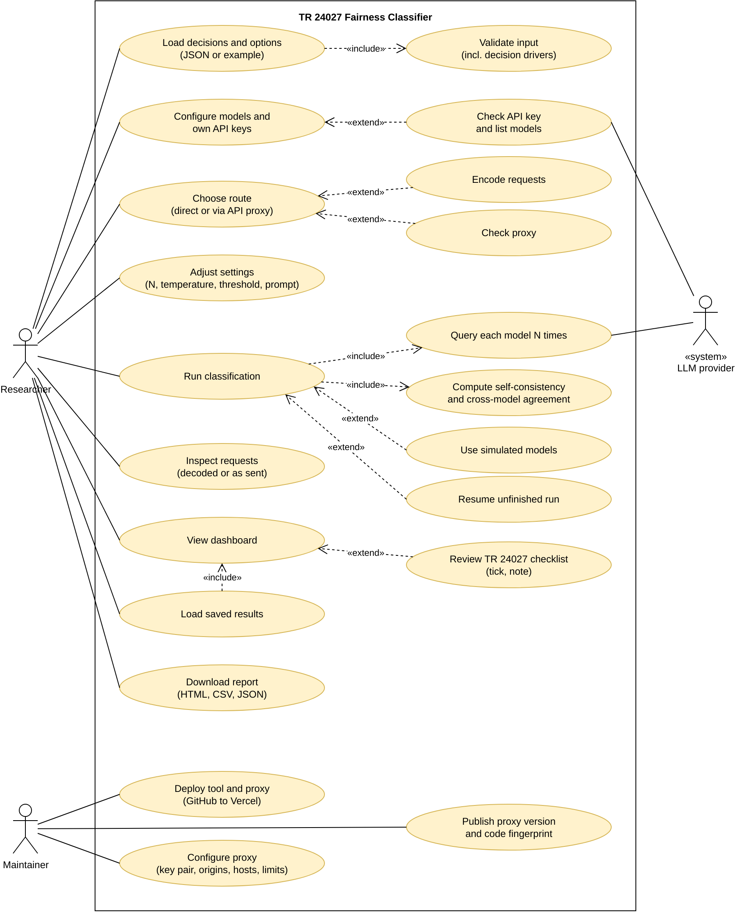
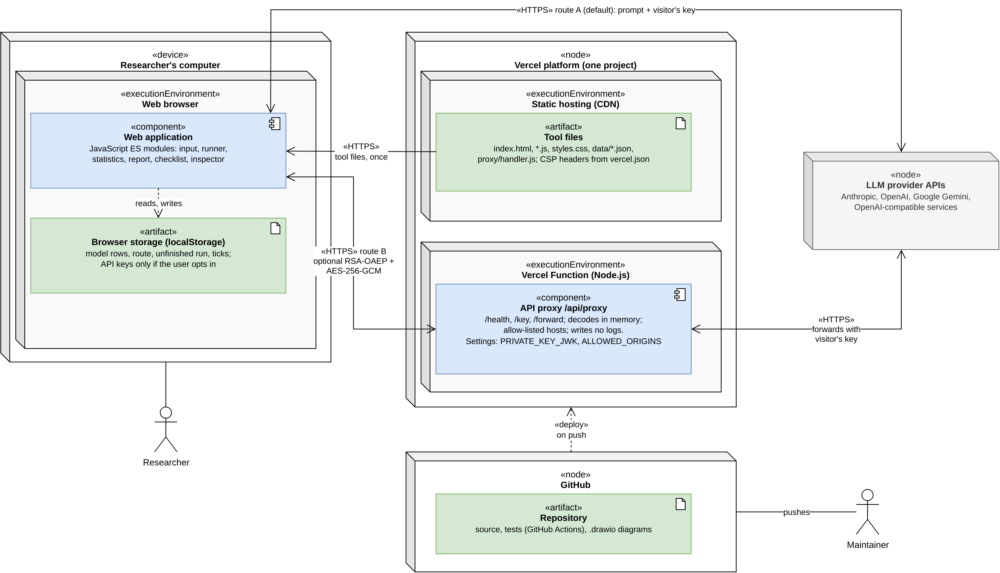
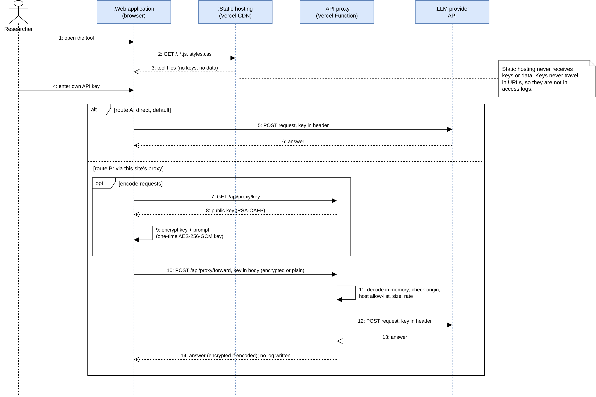

# TR 24027 Fairness Classifier

A browser tool that classifies design decision options by their **primary source of potential bias** and the **specific bias type**, following clause 6 of **ISO/IEC TR 24027:2021** (*Bias in AI systems and AI aided decision making*):

| Label | Meaning (default definition, editable in the tool) |
|---|---|
| **Data** | Bias originating in the data used to build, test or operate an AI-aided feature |
| **Cognitive** | Bias originating in the human judgement of the people who design, build, label, operate or oversee the system |
| **Engineering** | Bias introduced by technical and design decisions about the system |
| **None** | No plausible pathway to systematically different treatment of people or groups |

With each label, the model also picks the bias type (sub-clause) under that source, for example *6.2.2 automation bias* or *6.3.4 non-representative sampling*. The report ends with a **checklist of every bias type** in clause 6, showing which options address it and which types are **gaps**.

It turns general-purpose LLMs ("System 2") into a fast labeller with a probability-like confidence ("System 1") by **self-consistency**, and checks reliability by **cross-model agreement**:

1. Each option is sent **N times** (default 10) to each model at a temperature above zero.
2. The **majority label** is the model's answer; the **share of runs** that gave it is the model's **confidence**.
3. Up to **three models** (Claude, GPT, Gemini) do this independently. The tool reports **Fleiss' κ** (all models) and **pairwise Cohen's κ** with **bootstrap 95% confidence intervals**, for all four labels, for *Step 1* (fairness-relevant vs. None) and for *Step 2* (bias source, on items every model judged relevant).
4. An item gets a **final label** when the models whose confidence is at or above the threshold (default 0.8) agree — fully or by majority. Otherwise it is **Contested**.

Everything runs in the browser. By default, API keys and data go **directly from the user's browser to the chosen providers**, with no server in between. An optional route through the site's own **API proxy** is available for those who need it (see *Architecture*).


## Use it

Two ways to open the tool:

* **Single file:** `dist/tr24027-classifier.html` contains the whole tool, including the example data. Download it and double-click it; no installation or web server needed. You can also e-mail it to colleagues.
* **Website:** deploy the repository on Vercel (see *Deploy on Vercel* below) and share the link.

Then:

1. **Decisions and options** — upload one or more JSON files, or use the included example.
2. **Models and API keys** — for each row, choose a provider (Anthropic, OpenAI, Google, or any *OpenAI-compatible* service such as OpenRouter, DeepSeek, Groq, Mistral or a local server, with its base URL), a model ID, and the **name** you want in the report. Add up to six rows; tick the ones to use. *Check key* confirms the key and lists the models it can use. Tick *Use simulated models instead* to try the tool without keys (simulated answers, not research data).
3. **Settings** — N, temperature, acceptance threshold, parallel requests, rate limit, retries, label-order shuffling, the prompt, the label definitions, and the list of bias types (JSON).
4. **Run** — progress per model, live partial results, *Cancel* and *Resume*. An unfinished run is saved in the browser (without keys) and can be resumed after closing the tab.

### Results

Results are laid out like the results section of a paper:

* **Summary** — a results paragraph written for you in APA style (for example, *Fleiss' κ = .77, 95% CI [.67, .85]*), with a *Copy text* button.
* **Figures** — final label per item by voice, majority label per model, and confidence distributions.
* **Tables** — self-consistency per model; agreement (κ, 95% CI, observed and chance agreement, n, Landis and Koch); fairness-relevant options per decision; all items, filterable, with every model's votes.
* **Methods** — model IDs, temperatures actually used, label definitions, formulas, procedure, the exact prompt, and limitations.
* **Checklist: ISO/IEC TR 24027 bias types** — every bias type in clause 6 (6.2 human cognitive, 6.3 data, 6.4 engineering decisions) with its status (*Addressed* or *Gap*), the items that address it, and a *Reviewed* tick box and note field for your own check. Ticks and notes are kept in the browser and print with the report.

Figures and tables are numbered and captioned, so they can be cited in a paper. Confidence intervals are percentile bootstrap intervals over items (2,000 resamples, fixed seed 24027), so they are identical every time the same results are opened.

Downloads:

| File | Content |
|---|---|
| **Report (HTML)** | The same dashboard as a single self-contained file — opens offline, filters work, prints to PDF. The full result data is embedded, so the report can be re-loaded into the tool. |
| **CSV** | One row per item: each model's majority label, confidence, entropy and vote counts, plus agreement, final label and status. |
| **Full data (JSON)** | Everything, including every single model response, label order and timing — for replication. Re-load it with *Load saved results*. |

API keys are never written into any of these files.

## Input format

```json
{
  "title": "My study",
  "context": "Short description of the system, sent with every question",
  "decisions": [
    {
      "id": "D1",
      "question": "How to accommodate users with disabilities?",
      "source": "Practitioner",
      "category": "Immersive experience",
      "drivers": ["Fairness (+)"],
      "options": [
        { "id": "D1-O1", "text": "Assistive technology compatibility",
          "drivers": ["Accessibility (++)", { "name": "Cost", "effect": "-" }] },
        "Multilingual support"
      ]
    },
    { "id": "D2", "question": "How to manage an AI governance framework?" }
  ]
}
```

* `id` and `question` are required; `source`, `category`, `drivers` and `options` are optional.
* **Decision drivers** (optional) are the quality attributes (forces) a decision or option affects, as in QOC analysis: `"Transparency (+)"` or `{ "name": "Transparency", "effect": "+" }`. Effects: `++` strongly supports, `+` supports, `N` neutral, `-` hurts, `--` strongly hurts; the effect may be left out. Drivers on a decision apply to all its options. A setting decides whether drivers go into the prompt; either way the report shows a table of drivers against final bias sources.
* Each option is classified separately. A decision without options (like `D2`) is classified at question level.
* Option IDs must be unique across all files; options given as plain strings get IDs like `D1-O2`.
* `source` is used to group results (for example, *Practitioner* vs. *Industry* voice).

`data/ethical-ai-metaverse.json` contains the industry voice on ethical AI-metaverse integration, built from the QOC model `ADD4Ethics.py` (its SHA-256 is recorded in the file's `notes`): 32 decisions and 74 items, that is 72 options (64 distinct; options linked to several questions are classified in each question's context) and 2 questions without options, classified at question level (C4-Q3, C7-Q10). Every option carries its full text from the model, its decision drivers (the forces with their effect) and, where the manuscript's tables use one, the short `paper_label`.

## Cost and time

Calls = items × models × N. The example dataset with three models and N = 10 is 74 × 3 × 10 = **2,220 short calls** (about 900 input and 30 output tokens each, since the prompt lists the bias types). With 4 parallel requests per model this typically takes 10–20 minutes. Free tiers often have low rate limits: set *Max requests per minute* to stay under them; the tool also retries automatically on rate-limit errors.

Models that only accept their default temperature (some reasoning models) are detected automatically and run at their default; the method section of the report says so.

## Architecture

The tool runs entirely in the visitor's browser. Everything is hosted as **one Vercel project** built from the GitHub repository: static files for the tool, and one Vercel Function, the optional **API proxy** at `/api/proxy`. The **transport** sends each request either **directly** to the provider (route A, default) or **via the API proxy** (route B). Every request is recorded by the **request inspector**, which shows it *decoded* or *as it left the browser*, always with API keys shortened.

All diagrams are drawn in **draw.io** using **UML 2.5** notation. The editable `.drawio` sources are in `docs/uml/`, each with a PNG and an SVG export. The C4 model's levels are drawn with UML elements, so one standard notation covers every diagram:

| Diagram | UML 2.5 diagram type | File in `docs/uml/` |
|---|---|---|
| Research design | activity diagram with object nodes | `research-design-activity` |
| Industry-voice study method | activity diagram with partitions | `industry-voice-method-activity` |
| QOC model per category (C1–C7) | object-diagram style: `«decision»`, `«design solution»`, `«force»` | `qoc-c1` … `qoc-c7` |
| Use cases | use case diagram | `use-case` |
| C4 level 1, system context | component diagram (`«system»`, `«external system»`, actors) | `c4-l1-context` |
| C4 level 2, containers | deployment diagram (nodes, execution environments, artifacts) | `c4-l2-container` |
| C4 level 3, components | component diagram with ports and provided/required interfaces | `c4-l3-component` |
| Key flow | sequence diagram with `alt` and `opt` fragments | `key-flow-sequence` |
| User journey | activity diagram with partitions | `user-journey-activity` |

C4 level 4 (code) is the source itself; the module list under *Development* maps each file to its component. The interface design of each step of the user journey is in `docs/user-journey/`. `docs/key-flow.svg` is the simplified key-flow picture shown on the tool's page.

To re-export after editing a diagram in draw.io (desktop app, command line):

```bash
drawio -x -f pdf --crop -o docs/uml/use-case.pdf docs/uml/use-case.drawio
drawio -x -f png -s 2 -o docs/uml/use-case.png docs/uml/use-case.drawio
```







### Routes

| Route | Path of the key | Who can read the key | Needs |
|---|---|---|---|
| **Direct** (default) | browser → provider | the browser and the provider | nothing |
| **Via API proxy, not encoded** | browser → `/api/proxy` → provider | browser, proxy function, provider | nothing extra |
| **Via API proxy, encoded** | browser → `/api/proxy` → provider; the request is encrypted for the proxy (RSA-OAEP with SHA-256 wraps a one-time AES-256-GCM key) on top of HTTPS | browser, proxy function (in memory, while forwarding), provider | `PRIVATE_KEY_JWK` set on Vercel |

Encoding keeps keys and prompts unreadable in any logs between the browser and the proxy. It cannot hide the key from the proxy itself, which must decode it to call the provider. Trust in the proxy therefore comes from its open code (`proxy/handler.js`, also served at `/proxy/handler.js` on the site), its published version and code fingerprint, and the inspector, which lets every user see exactly what was sent.

## The API proxy (optional route)

`proxy/handler.js` holds the whole proxy; `api/proxy.js` runs it as a Vercel Function. It forwards each request with **the visitor's own key** and holds no keys of its own. It helps when a visitor's network blocks the providers, or for a service that does not accept browser calls (add its host to `ALLOWED_HOSTS`).

* `GET /api/proxy/health`: version, allow-listed hosts, whether encoding is available, `"logging": "none"`.
* `GET /api/proxy/key`: the public key for encoded requests.
* `POST /api/proxy/forward`: forwards one request to an **allow-listed host only** (not an open proxy), passes only API-key, version and content-type headers, limits request size and rate per address, and **writes nothing** to logs or storage.
* Only pages of the same deployment may call it (unless `ALLOWED_ORIGINS` says otherwise), so other websites cannot use your proxy.

## Deploy on Vercel

The repository stays on GitHub; Vercel deploys it. Every push to `main` updates the site, and every pull request gets a preview address. GitHub Actions (`.github/workflows/ci.yml`) runs the tests on each push, so a broken commit shows a red check.

1. **Push the repository to GitHub.** `proxy/private-key.json` is git-ignored; never commit it.
2. **Set the source-code link:** in `index.html`, replace `https://github.com/OWNER/REPOSITORY` in `<meta name="repository">` with your repository's address.
3. **Create the key pair** (only needed for encoded requests): `npm run proxy:keygen` writes `proxy/private-key.json`.
4. **Import on Vercel:** vercel.com → **Add New → Project → Import** the GitHub repository. Framework preset **Other**; leave build and output settings empty. (`vercel.json` already sets the rewrite and the security headers.)
5. **Environment variables** (Project → Settings → Environment Variables):

   | Name | Value | Needed |
   |---|---|---|
   | `PRIVATE_KEY_JWK` | content of `proxy/private-key.json`; mark **Sensitive** | for encoding |
   | `ALLOWED_ORIGINS` | extra web origins allowed to use the proxy, comma-separated, e.g. your custom domain | no; default is the deployment's own address |
   | `ALLOWED_HOSTS` | provider hosts the proxy may call | no; default Anthropic, OpenAI, Gemini |
   | `RATE_LIMIT_PER_MIN` / `MAX_BODY_BYTES` | limits | no; 120 / 200000 |

6. **Redeploy** (Deployments → ⋯ → Redeploy) so the variables take effect.
7. **Check:** open `https://<project>.vercel.app/api/proxy/health`; it should show `"encoding": true` and `"logging": "none"`. In the tool, choose **Via API proxy** (the address `/api/proxy` is filled in) and press **Check proxy**.

From the command line instead: `npx vercel link`, `npx vercel env add PRIVATE_KEY_JWK production`, then `npm run deploy`.

Recommended Vercel settings:

* Leave **Web Analytics** and **Speed Insights** off, so the page loads nothing beyond its own files (the privacy promise of the tool).
* Optional: a custom domain (Settings → Domains). Add it to `ALLOWED_ORIGINS` if visitors use it for the proxy route.
* Preview deployments get their own address; the proxy accepts calls from that address automatically.

Notes: Vercel keeps its own request logs (time, method, path, status); the proxy itself writes nothing, and request bodies (with the key) are not part of those logs. The per-address rate limit is kept in memory per function instance, so it is a soft limit. A function call may run up to 60 seconds (`maxDuration` in `api/proxy.js`), enough for one model call.

### Publish what you deploy

`npm run proxy:hash` prints the SHA-256 fingerprint of `proxy/handler.js`. State the proxy version (from `/health`) and this fingerprint in your paper. Anyone can download `/proxy/handler.js` from the site and compare.

### Run locally

```bash
npm start            # http://localhost:3000, with the proxy at /api/proxy
```

`dev-server.mjs` serves the tool with the same rewrite and security headers as `vercel.json` and runs the proxy function; no Vercel account is needed. If `proxy/private-key.json` exists, encoding is on. (`npx vercel dev` works too.)

## Privacy and security

The diagram at the top shows the path of a key on both routes. In short:

* Keys are kept in memory only, unless the user ticks *Remember keys in this browser* (stored unencrypted in local storage).
* On route A (direct) only the browser and the provider handle the key. On route B the site's API proxy function handles it too, in memory, while forwarding; use the inspector to see what was sent.
* The page is served with a Content Security Policy: it runs only its own scripts, loads nothing from other sites, and cannot be framed by other pages.
* Requests go straight to `api.anthropic.com`, `api.openai.com` and `generativelanguage.googleapis.com`. All three accept direct browser calls (CORS); this was checked from a real browser on 13 October 2026. Anthropic requires the `anthropic-dangerous-direct-browser-access` header for browser calls; the tool sets it.
* For an *OpenAI-compatible* service, browser access depends on that service. If *Check key* says the service cannot be reached, it probably does not accept browser calls.
* Because each user brings their own key, a public deployment costs the host nothing, and users only spend their own quota. Users should still create **separate, limited keys** (spending limits or project keys) for browser tools.
* The request inspector keeps its records only in the open page; they are never saved or downloaded, and keys in them are always shortened.

## Limitations

* **Agreement is reliability, not correctness.** Models trained on similar data can share the same errors. The tool includes no human validation; report this as a threat to validity.
* The default definitions and the **clause numbers of the bias types** follow the tool author's reading of TR 24027. Check them against the standard (and cite the clauses) before publishing; edit them in *Prompt and label definitions* — the report records the exact wording used.
* Each option gets **one primary** source; options with several sources lose information.
* Model behaviour changes over time. The report records model IDs and dates; pin model versions where providers allow it.

## Development

```
build.mjs       bundles everything into dist/tr24027-classifier.html
index.html      page structure
app.js          page logic: inputs, keys, route, inspector, running, downloads
core.js         prompt, parsing, drivers, self-consistency, kappa, checklist, CSV (no DOM, no network)
transport.js    direct or via proxy, encoding, inspector records with keys masked
providers.js    requests and answers for Anthropic, OpenAI, Google, OpenAI-compatible + simulated models
runner.js       N runs per item per model, concurrency, rate limit, retries, resume
report.js       dashboard and standalone HTML report (one renderer for both)
styles.css      styles (light/dark, print)
data/           example input files
api/proxy.js    Vercel Function: runs the API proxy at /api/proxy
proxy/          handler.js (the whole proxy), keygen.mjs (key pair)
vercel.json     rewrite for /api/proxy/* and security headers
dev-server.mjs  local preview of the Vercel deployment (npm start)
docs/uml/       UML 2.5 diagrams in draw.io (.drawio sources + PNG, SVG): use case, C4 levels 1-3, key flow, user journey
docs/user-journey/  interface design of each step of the user journey
test/           unit tests (node): core, providers, proxy, Vercel function; kappa reference values
```

```bash
npm run build            # rebuilds dist/tr24027-classifier.html after any change
npm test                 # runs all tests with Node 18+ and rebuilds the single file
python3 test/reference.py  # optional: regenerate kappa reference values (needs scikit-learn, statsmodels)
```

The kappa functions are checked against scikit-learn (`cohen_kappa_score`) and statsmodels (`fleiss_kappa`).

## License

MIT — see `LICENSE`.
